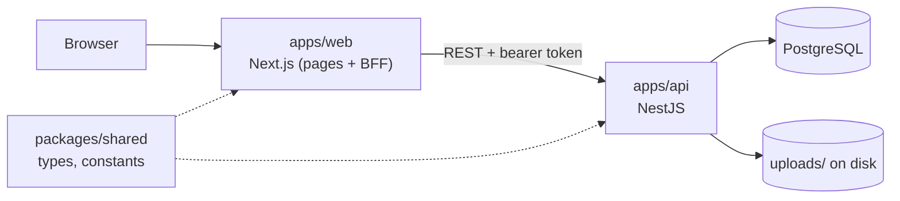

# Vehicle Auction Platform

A sealed-bid auction platform for used electric vehicles. An admin lists vehicles and schedules auctions; dealers bid while an auction is live; after it ends the admin confirms the sale to the highest bidder or marks the vehicle unsold.

## Features

- Two roles, `ADMIN` and `DEALER`, each with its own area of the app.
- Vehicle inventory with EV data (battery capacity, state of health, range) and photo upload.
- Timed auctions with a starting price, a hidden reserve price and a minimum increment.
- Sealed bidding: a dealer sees only their own bids, never other dealers' bids, the reserve or the result details.
- Admin review of ended auctions: confirm sold or mark unsold.
- Dealer "My bids" view with the status of each bid (active, pending, won, not won).

## Architecture

pnpm + Turborepo monorepo with two applications and one shared package.



- The browser only ever talks to the Next.js app. Next forwards API calls to NestJS and attaches the user's token.
- NestJS owns all data, rules and authorization.
- `@repo/shared` holds the types and constants both sides must agree on.

## Repository structure

```
.
├── apps/
│   ├── api/                  NestJS REST API
│   │   ├── src/
│   │   │   ├── auth/         login, JWT guard, role guard
│   │   │   ├── users/
│   │   │   ├── vehicles/     vehicles, photo upload, availability lists
│   │   │   ├── auctions/     auctions, status sync, results, my-bids
│   │   │   ├── bids/         placing bids
│   │   │   ├── health/
│   │   │   └── seed.ts       dev database reset + demo data
│   │   ├── seed-photos/      demo vehicle photos
│   │   └── test/             integration tests
│   └── web/                  Next.js app
│       ├── app/              routes: /login, /admin, /dealer, /api (BFF)
│       ├── features/         auctions and vehicles (components, data, hooks, server)
│       ├── components/       shared UI, sidebar, shadcn/ui components
│       ├── lib/              fetch helpers, auth/session, formatting
│       └── proxy.ts          route protection by session and role
├── packages/
│   └── shared/               @repo/shared
├── docker-compose.yaml       PostgreSQL for local development
├── turbo.json
└── pnpm-workspace.yaml
```

## Technology stack

| Area     | Used                                                                          |
| -------- | ----------------------------------------------------------------------------- |
| Monorepo | pnpm workspaces, Turborepo                                                    |
| Web      | Next.js 16 (App Router), React 19, TanStack Query, nuqs, React Hook Form, Zod |
| UI       | Tailwind CSS 4, shadcn/ui on Base UI, lucide-react                            |
| API      | NestJS 12, class-validator, Swagger                                           |
| Database | PostgreSQL 17, TypeORM                                                        |
| Auth     | JWT (`@nestjs/jwt`), bcrypt, httpOnly cookie on the web side                  |
| Uploads  | multer, stored on the API's local disk                                        |
| Tests    | Vitest (API)                                                                  |
| Tooling  | TypeScript, ESLint, Prettier, knip                                            |

## Getting started

### Prerequisites

- Node.js (the web config uses `process.loadEnvFile`, so 20.12 or newer)
- pnpm 12.8.1 (pinned in `package.json`)
- Docker, for PostgreSQL

### Setup

```bash
pnpm install

cp .env.example .env        # then set JWT_SECRET and POSTGRES_PASSWORD

docker compose up -d db     # start PostgreSQL
pnpm db:reset               # create demo data (wipes existing data)
pnpm dev                    # build shared, then start web and API in watch mode
```

- Web: http://localhost:3000
- API: http://localhost:3001/api
- Swagger UI: http://localhost:3001/api/docs

There are no migrations to run: in development TypeORM creates and updates the tables from the entities on startup.

### Demo users

`pnpm db:reset` creates:

| Email                | Role   |
| -------------------- | ------ |
| `admin@example.com`  | ADMIN  |
| `berlin@example.com` | DEALER |
| `munich@example.com` | DEALER |

All users share one password. Only its bcrypt hash is in the repository (`apps/api/src/auth/auth.service.ts`); the plaintext is not documented in the code, so ask a maintainer for it.

## Environment variables

One `.env` file in the repository root is read by Docker Compose, the API and the web app. It is git-ignored; copy `.env.example` to create it. The example values work for local development, but replace `JWT_SECRET` and `POSTGRES_PASSWORD` with your own.

| Variable            | Used by      | Purpose                                                                |
| ------------------- | ------------ | ---------------------------------------------------------------------- |
| `JWT_SECRET`        | API          | **Required.** Signs and verifies access tokens.                        |
| `JWT_EXPIRES_IN`    | API          | Token lifetime. Optional, default `1h`.                                |
| `POSTGRES_USER`     | Compose, API | Database user. Default `user`.                                         |
| `POSTGRES_PASSWORD` | Compose, API | Database password. Default `password`.                                 |
| `POSTGRES_DB`       | Compose, API | Database name. Default `db`.                                           |
| `DB_PORT`           | Compose, API | Host port for PostgreSQL. Default `5432`.                              |
| `DB_HOST`           | API          | Database host. Optional, default `localhost`.                          |
| `DATABASE_URL`      | API          | Optional connection URL, passed to TypeORM alongside the fields above. |
| `DB_SYNC`           | API          | Set to `false` to stop TypeORM syncing the schema. Optional.           |
| `PORT`              | API          | Port the API listens on. Optional, default `3001`.                     |
| `API_ORIGIN`        | Web          | Base URL of the API. Optional, default `http://localhost:3001`.        |
| `WEB_APP_NAME`      | Web          | Name shown in the sidebar. Optional.                                   |

`API_PORT`, `WEB_PORT` and `WEB_ORIGIN` are not read by any code and are left out of `.env.example`: the API listens on `PORT`, and the web app uses Next's default port.

## Commands

Run from the repository root.

| Command                             | What it does                                                                                                         |
| ----------------------------------- | -------------------------------------------------------------------------------------------------------------------- |
| `pnpm dev`                          | Builds `@repo/shared`, then runs every package's `dev` task (web, API, shared in watch mode).                        |
| `pnpm build`                        | Builds all packages in dependency order.                                                                             |
| `pnpm lint`                         | ESLint in all packages.                                                                                              |
| `pnpm typecheck`                    | TypeScript check in all packages.                                                                                    |
| `pnpm format` / `pnpm format:check` | Prettier over the repository.                                                                                        |
| `pnpm knip`                         | Reports unused files, exports and dependencies.                                                                      |
| `pnpm db:reset`                     | API only: wipes the database and uploaded photos, then inserts demo data. Refuses to run when `NODE_ENV=production`. |
| `pnpm test:e2e`                     | API only: integration tests (needs PostgreSQL running).                                                              |

To target one package, use a filter, for example `pnpm --filter @repo/api test` or `pnpm --filter web dev`.

## Applications

### Web (`apps/web`)

Next.js App Router application with three areas:

- `/login`
- `/admin` — auctions (list, detail, create), vehicles (list by availability, detail with auction history, create)
- `/dealer` — auctions (scheduled and live), my bids (list, detail)

Key patterns:

- **Route protection** (`proxy.ts`): logged-out users are sent to `/login`; logged-in users are kept inside their own role's area. The proxy reads the token without verifying it, only to choose a page. The API verifies every data request.
- **Session**: on login, Next stores the API's access token in an httpOnly cookie (`accessToken`). JavaScript in the browser never sees it.
- **BFF**: browser requests go to `/api/*` on the Next app (`app/api/[...path]/route.ts`), which forwards them to NestJS with the cookie turned into a bearer token. `/uploads/*` is rewritten to the API as well.
- **Data fetching**: TanStack Query. Server pages prefetch the query so the data is in the first render instead of loading empty and then fetching. On the server they call NestJS directly, since the server can read the auth cookie itself and an extra hop through its own BFF would be pointless. The query key is the same one the client uses, so the client picks the data up from the cache. If the prefetch fails, the client simply fetches again through the BFF.
- **URL state**: list filters (`phase`, `availability`) live in the query string via nuqs and drive both the sidebar highlight and the breadcrumbs. A detail page compares the filter in its URL with the item's real state and redirects to the matching URL on load, so a stale or missing filter corrects itself.
- **Feature folders**: `features/auctions` and `features/vehicles` each hold their components, query definitions (`data/`), hooks and server prefetch functions.

`/admin` and `/dealer` are placeholder pages.

### API (`apps/api`)

NestJS REST API under the `/api` prefix.

- **Auth**: `POST /api/auth/login` is the only public route. Two global guards protect everything else: one verifies the bearer token, the other enforces `@Role('ADMIN' | 'DEALER')` where a handler declares it.
- **Validation**: a global `ValidationPipe` with DTO classes; unknown fields and unknown query parameters are rejected.
- **Modules**:
  - `vehicles` (admin): create, list by availability, counts, detail with auction history, photo upload.
  - `auctions`: create and decide results (admin); list by phase, counts and detail (both roles, with dealer-specific views); my-bids list, counts and detail (dealer).
  - `bids` (dealer): place a bid on an auction.
  - `health`: database check (requires a token like every other route).
- **Role-specific responses**: for dealers, `reservePrice`, `result` and `winningBidId` are stripped from auctions.
- **Photos**: uploaded to `apps/api/uploads/vehicles` and served under `/uploads`. JPEG, PNG or WebP, up to 5 MB each and 10 per vehicle.

Swagger documents every endpoint at `/api/docs`.

## Shared package (`packages/shared`)

`@repo/shared` is a plain TypeScript package consumed by both applications as a workspace dependency. It contains:

- Constants: user roles, auction statuses, results and phases, bid statuses, vehicle availabilities, upload limits.
- Types and interfaces for the API's request and response shapes (for example `AuctionDetailAdmin`, `AuctionDetailDealer`, `VehicleSummary`).
- `getMinimumBid`, the one piece of logic both sides run: the API to validate a bid, the web app to show the minimum.

The applications import its compiled output (`dist/`), so it must be built before they start. `pnpm dev` and `pnpm build` do this through Turborepo, and in `dev` it rebuilds on change.

## Core domain

### Auction lifecycle

```
SCHEDULED ──start time──▶ LIVE ──end time──▶ ENDED ──admin──▶ SOLD or UNSOLD
```

- An auction has a `status` (`SCHEDULED`, `LIVE`, `ENDED`) and, once decided, a `result` (`SOLD`, `UNSOLD`).
- A background job in the API runs every 10 seconds and moves auctions to `LIVE` at their start time and `ENDED` at their end time. This is not ideal, but it is a simple solution.
- The UI groups auctions into phases: `SCHEDULED`, `LIVE`, `PENDING` (ended, awaiting a result) and `COMPLETED` (sold or unsold). Dealers get `SCHEDULED` and `LIVE` only; their `LIVE` list leaves out auctions they have already bid on and is labelled "Open to bid".

### Bidding

- Only dealers can bid, and only while the auction is `LIVE` and before its end time.
- A dealer's first bid must be at least the starting price; each later bid must exceed their own previous highest by the minimum increment. The minimum does not depend on other dealers' bids.
- A dealer can see the auction and their own highest bid, nothing else.

### Deciding the result

- **Confirm sold**: allowed only for an ended auction with no result. The highest bid wins; on equal amounts the earlier bid wins. It is refused when there are no bids or the highest bid is below the reserve price.
- **Mark unsold**: allowed only for an ended auction with no result.
- A result cannot be changed once given.

### Vehicles

Every vehicle is in exactly one availability list, derived from its auctions:

- `AVAILABLE` — never been in an auction, or all its auctions ended unsold
- `IN_AUCTION` — has an auction with no result yet (scheduled, live or pending)
- `SOLD` — has an auction that ended sold

An auction can only be created for an `AVAILABLE` vehicle; the API refuses it otherwise. A vehicle whose auction ended unsold is available again and can be relisted from its page, which also lists all its auctions.

### Dealer bid status

`ACTIVE` (auction not ended), `PENDING` (ended, no result; shown as "Awaiting result"), `WON`, `NOT_WON` (sold to someone else, or unsold).

There is no payment handling and no user registration; users exist only through the seed script.

## Database

- PostgreSQL, accessed through TypeORM entities: `users`, `vehicles`, `auctions`, `bids`.
- **No migrations.** The schema is synchronised from the entities at startup unless `DB_SYNC=false`. This is a development setup; the code marks it "dev only".
- `pnpm db:reset` truncates all tables, clears uploaded photos and seeds 12 vehicles, 3 users, 12 auctions in every state and a set of bids. Several seeded auctions start or end within minutes so the lifecycle can be watched.
- Prices are whole currency units; the web app formats them as EUR.

## Testing

Tests exist for the API only.

- `pnpm test:e2e` — integration tests in `apps/api/test/` for the core auction rules: opening and closing by time, rejecting bids after close, winner selection including tie-breaks and the reserve price, and results being final.
  - They run against a separate database named `<POSTGRES_DB>_test` on the same PostgreSQL instance. It is created automatically and rebuilt on every run; the development database is not touched.
- `pnpm --filter @repo/api test` — unit tests. Currently only the generated sample spec.

The web app has no tests.

## Deployment

Not configured. The repository has no Dockerfiles for the applications, no CI/CD configuration and no hosting configuration; `docker-compose.yaml` only provides the development database. Before any production use, note that the schema relies on TypeORM `synchronize`, uploads are stored on the API's local disk, and all users share one hard-coded password hash.

## Troubleshooting

- **API fails at startup with a missing `JWT_SECRET`**: the root `.env` is missing or incomplete; copy it from `.env.example`.
- **API cannot connect to the database**: check `docker compose ps` and that `DB_PORT` in `.env` matches the published port.
- **Types or constants from `@repo/shared` look stale**: the apps read its `dist/` folder. Run `pnpm --filter @repo/shared build`, or keep `pnpm dev` running.
- **An auction's status lags a few seconds behind its countdown**: expected. The status job runs every 10 seconds, and the web app refetches every 5 seconds once a countdown has passed.
- **`pnpm test:e2e` cannot connect**: the tests need the same PostgreSQL container as development.

## Photo credits

The demo vehicle photos in `apps/api/seed-photos` come from [Wikimedia Commons](https://commons.wikimedia.org) and are used under CC BY-SA 4.0, CC BY 3.0 or CC0 licences. They are used only by the development seed. The title, author and licence of every photo are listed in [apps/api/seed-photos/CREDITS.md](apps/api/seed-photos/CREDITS.md).
